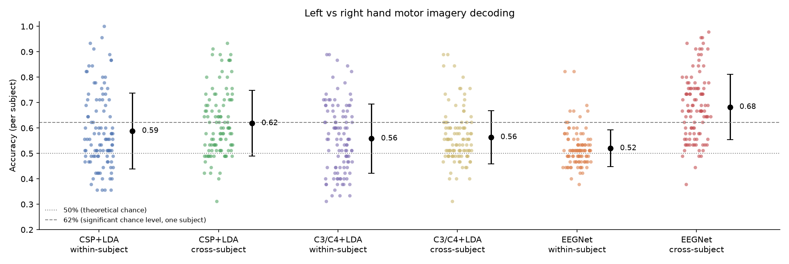

# Motor Imagery EEG Decoding: CSP+LDA vs EEGNet


Can we tell from brain signals alone whether a person is **imagining** moving their left hand or their right hand? And does a decoder trained on some people still work on **people it has never seen**?

This repository compares a classic neuroscience pipeline (**CSP + LDA**) with a compact deep network (**EEGNet**) on the public PhysioNet EEG Motor Movement/Imagery dataset, under two evaluation schemes:

| Scheme | Train on | Test on | Question it answers |
|---|---|---|---|
| Within-subject | Part of one person's trials | Other trials from the same person | Does the decoder work after calibration? |
| Cross-subject | Some people | Different people (held out by subject) | Does it generalize to a new brain without calibration? |

Many tutorials only report within-subject accuracy, or split trials randomly so the same person appears in both training and test data. That inflates results. Here, the cross-subject split is enforced by subject ID, and a test checks it.

## Results

> Run `eegdecode run --config configs/default.yaml`, then fill in this table from `results/results.json`.

| Method | Within-subject | Cross-subject |
|---|---|---|
| CSP + LDA | _xx ± xx %_ | _xx ± xx %_ |
| C3/C4 + LDA | _xx ± xx %_ | _xx ± xx %_ |
| EEGNet | — | _xx ± xx %_ |



**Chance level.** With about 45 trials per person, guessing can reach well above 50% by luck. A single subject's accuracy must exceed about 62% to be significant at p < 0.05 (binomial test, Combrisson & Jerbi, 2015). The figure shows both lines.

**What I found:** _Write 3–5 sentences here after running: which method won in each scheme, how much accuracy dropped from within- to cross-subject, how many people were above chance, and one thing that surprised you._

## Method

**Data.** PhysioNet EEG Motor Movement/Imagery (Schalk et al., 2004; Goldberger et al., 2000). 64-channel EEG at 160 Hz. Runs 4, 8 and 12: the participant imagines opening and closing the left fist (T1) or right fist (T2). Subjects 88, 89, 92, 100 and 104 are excluded because of recording inconsistencies.

**Preprocessing** (MNE-Python):
1. Band-pass filter 7–30 Hz. Motor imagery reduces power in the mu (8–12 Hz) and beta (13–30 Hz) rhythms over the sensorimotor cortex opposite the imagined hand.
2. Epoch 0.5–2.5 s after the cue, which skips the visual response to the cue itself.
3. Resample to 128 Hz, the rate EEGNet was designed for.

**Models.**
- **CSP + LDA.** Common Spatial Patterns learns 6 spatial filters that maximize the variance difference between classes (with Ledoit-Wolf shrinkage). Linear discriminant analysis classifies their log-variance.
- **EEGNet-8,2** (Lawhern et al., 2018). A temporal convolution (learned frequency filters), a depthwise spatial convolution (learned, CSP-like spatial filters), then a separable convolution. Built with Keras 3 on the PyTorch backend. Inputs are divided by one scale factor computed on the training data, which keeps the power differences between channels that carry the motor imagery signal. (An earlier version scaled each channel separately; that erased the signal and left EEGNet at chance. A regression test now guards against it.) Early stopping uses held-out **subjects** from the training set, not random trials.
- **C3/C4 + LDA.** A one-feature baseline: linear discriminant analysis on the log-power difference between electrodes C3 and C4, which sit over the left and right hand areas of the motor cortex. It tests how much the learned spatial filters add over the known physiology.

**Evaluation.** Within-subject: 5-fold stratified cross-validation per person. Cross-subject: 5-fold `GroupKFold` by subject. All settings live in `configs/default.yaml`, and the random seed is fixed.

## Quick start

```bash
git clone https://github.com/Muzz698/eeg-motor-imagery-decoding.git
cd eeg-motor-imagery-decoding
conda create -n eeg python=3.12 -y && conda activate eeg   # or: python3.12 -m venv .venv
pip install -e ".[dev]"

pytest                                             # tests use synthetic EEG, no download
eegdecode run --config configs/quick.yaml          # 5 subjects, about 5 minutes
eegdecode run --config configs/default.yaml        # 20 subjects, the main experiment
eegdecode run --config configs/default.yaml --subjects 1-109   # full dataset
```

The first run downloads the data automatically (about 2.5 MB per run file, 3 files per subject) into `~/mne_data`. Preprocessed subjects are cached in `data/cache/`, so later runs are fast.

**On Google Colab:** run `!git clone ...`, then `%cd eeg-motor-imagery-decoding` and `!pip install -e .`, then `!KERAS_TORCH_DEVICE=cuda eegdecode run --config configs/default.yaml` on a GPU runtime.

## Troubleshooting

- **`Failed building wheel for h5py`.** Your Python is too new (for example 3.15) and some packages have no ready-made installer for it yet. Use Python 3.10–3.12.

- **Segmentation fault when EEGNet starts (macOS / conda).** This is a known TensorFlow crash. The project now uses Keras with the PyTorch backend by default, which avoids it. Reinstall with `pip install -e ".[dev]"` inside a fresh virtual environment, not the conda `base` environment.
- **EEGNet predicts only one class on a Mac.** Training on Apple's GPU (MPS) gave wrong results, so the code uses the CPU by default. Do not set `KERAS_TORCH_DEVICE=mps`.
- **Want TensorFlow instead?** Install it and run `KERAS_BACKEND=tensorflow eegdecode run ...`.
- **Only need the classic baseline?** Add `--skip-eegnet`.

## Repository layout

```
src/eegdecode/
  data.py       download, filter, epoch, cache
  models.py     CSP+LDA and C3/C4+LDA pipelines, EEGNet, scikit-learn style EEGNet wrapper
  evaluate.py   within-subject and cross-subject evaluation, chance level
  plots.py      per-subject accuracy figure
  cli.py        `eegdecode run` command
configs/        experiment settings (default and quick)
tests/          synthetic-data tests, including a check that test subjects never appear in training
docs/REPORT.md  short write-up of the study
```

## Limitations and next steps

- Only 2 classes and about 45 trials per person; within-subject estimates are noisy.
- One fixed frequency band (7–30 Hz). A filter-bank CSP or a broader band for EEGNet may help.
- No artifact rejection (eye blinks, muscle). The next step is ICA or autoreject.
- Possible extensions: Riemannian geometry classifiers, fine-tuning a cross-subject EEGNet with a few trials from the new person (transfer learning), and an API that serves predictions.

## References

- Lawhern, V. J., et al. (2018). EEGNet: a compact convolutional neural network for EEG-based brain–computer interfaces. *Journal of Neural Engineering*, 15(5).
- Schalk, G., et al. (2004). BCI2000: a general-purpose brain-computer interface system. *IEEE Transactions on Biomedical Engineering*, 51(6).
- Goldberger, A., et al. (2000). PhysioBank, PhysioToolkit, and PhysioNet. *Circulation*, 101(23).
- Combrisson, E., & Jerbi, K. (2015). Exceeding chance level by chance. *Journal of Neuroscience Methods*, 250.
- Gramfort, A., et al. (2013). MEG and EEG data analysis with MNE-Python. *Frontiers in Neuroscience*, 7.

## License

MIT
