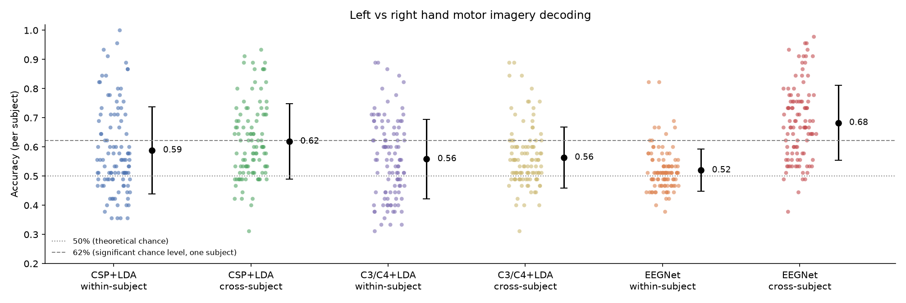

# Decoding imagined hand movements from EEG: does deep learning generalize across people?

**Author:** Muzamil · **Code:** github.com/Muzz698/eeg-motor-imagery-decoding

## 1. Question

Brain-computer interfaces usually need a calibration session for each new user. I ask (1) how well two classical decoders (CSP + LDA and a simple C3/C4 power comparison) and a deep network (EEGNet) decode left- versus right-hand motor imagery, and (2) how much accuracy is lost when the decoder must work on people it was never trained on.

This matters because calibration takes time and effort, which is a real cost for patients who might use these systems. A decoder that works on a new person from the start would remove that step.

## 2. Data and preprocessing

I used the PhysioNet EEG Motor Movement/Imagery dataset (Schalk et al., 2004; Goldberger et al., 2000): 64-channel EEG at 160 Hz, runs 4, 8 and 12, in which participants imagine opening and closing the left or right fist. Of the 109 subjects, 5 (88, 89, 92, 100 and 104) were excluded because of recording inconsistencies. That left 104 subjects and 4,680 trials (45 per person), with 2,360 left-hand and 2,320 right-hand trials.

Preprocessing used MNE-Python (Gramfort et al., 2013). I band-pass filtered at 7–30 Hz, because imagining a hand movement reduces power in the mu (8–12 Hz) and beta (13–30 Hz) rhythms over the opposite sensorimotor cortex, an effect called event-related desynchronization. I then cut epochs from 0.5 to 2.5 s after the cue, which skips the visual response to the cue itself, and resampled to 128 Hz. No artifact rejection was applied.

## 3. Methods

**CSP + LDA.** Common Spatial Patterns learns 6 spatial filters that maximize the variance difference between classes, with Ledoit-Wolf shrinkage. Linear discriminant analysis (LDA) then classifies the log-variance of the filtered signals.

**C3/C4 + LDA.** LDA classifies one feature: the log-power difference between electrodes C3 and C4, which sit over the left and right hand areas of the motor cortex. It has no learned spatial filters, so it shows how far known physiology goes on its own. I added it after a 5-subject pilot suggested it might do well, and before running the larger experiments.

**EEGNet-8,2** (Lawhern et al., 2018). A temporal convolution learns frequency filters and a depthwise convolution learns spatial filters for each of them. A separable convolution then combines these features over time. It was built with Keras 3 on PyTorch and trained for a fixed 100 epochs on the CPU, with dropout of 0.25 (0.5 for within-subject, where each model has only 36 training trials). Inputs were divided by one scale factor computed on the training data, which keeps the power differences between channels that carry the signal.

**Evaluation.** Within-subject evaluation used 5-fold stratified cross-validation on each person's trials, so each model trained on 36 trials. Cross-subject evaluation used 5-fold `GroupKFold` by subject, so no person appears in both training and test data within a fold. A test verifies this. Splitting by trial instead would let the model see the test person during training and would inflate accuracy. Methods were compared with paired Wilcoxon signed-rank tests across subjects, Holm-corrected over 7 comparisons.

**Chance level.** With few trials, guessing can score well above 50% by luck. Using a binomial test at p < 0.05 (Combrisson & Jerbi, 2015), one subject with 45 trials must exceed about 62%, and a method's accuracy over all 4,680 trials must exceed 51.2%. I compared methods per subject with Wilcoxon signed-rank tests.

## 4. Results

| Method | Within-subject | Cross-subject | Cross-subject, subjects 21–109 | People above 62%, within | People above 62%, cross |
|---|---|---|---|---|---|
| CSP + LDA | 58.9 ± 14.9% | 61.9 ± 1.2% | 62.4% | 33 of 104 | 43 of 104 |
| C3/C4 + LDA | 55.9 ± 13.6% | 56.4 ± 2.4% | 56.6% | 31 of 104 | 18 of 104 |
| EEGNet | 52.0 ± 7.2% | **68.3 ± 5.4%** | 69.0% | 7 of 104 | 67 of 104 |

Within-subject ± is the spread across people. Cross-subject ± is the spread across the 5 folds.

All three cross-subject accuracies are above chance. For people it had never seen, EEGNet beat CSP + LDA for 68 people and lost for 29 (+6.4 points, p < 0.00001), and beat C3/C4 + LDA for 80 and lost for 18 (+11.9 points, p < 0.00001). CSP + LDA beat C3/C4 + LDA for 67 people and lost for 29 (+5.5 points, p < 0.0001). These three differences remain significant after correcting for multiple comparisons, and they also hold on subjects 21–109 alone.

There was no drop from within- to cross-subject accuracy. CSP + LDA was 3.0 points higher cross-subject (p = 0.004), and C3/C4 + LDA was 0.5 points higher (p = 0.58).

EEGNet trained within-subject was close to chance: 52.0 ± 7.2% (range 38–82%; 52.7% on subjects 21–109), with only 7 of 104 people above 62%. It was worse than within-subject CSP + LDA for 67 people and better for 32 (p_Holm < 0.0001), and worse than cross-subject EEGNet for 90 of 104 people (p_Holm < 10⁻¹⁵). Its training accuracy was 0.8–0.95, so with 36 trials it memorized rather than learned.

Results depended strongly on the amount of training data. In an earlier run on only 20 subjects, EEGNet scored 53.6%, level with CSP + LDA (54.8%) and C3/C4 + LDA (57.0%). In the full run, those same 20 people averaged 65.3% with EEGNet, which was then trained on about 83 people rather than 16. The gap between final training accuracy and test accuracy fell from about 30 points to about 9.

## 5. Discussion

**EEGNet generalized best, but only with enough people.** The clearest finding is the dependence on data. With 16 training people, EEGNet mostly memorized them. With about 83, it outperformed both baselines. The within-subject run makes the same point from the other side: trained on a single person's 36 trials, EEGNet fell to 52%, below CSP + LDA, while the same network trained on about 83 people reached 68% on new people. I did not test why it wins, but one plausible explanation is that its learned frequency and spatial filters can capture patterns shared across people that a fixed 7–30 Hz band and 6 CSP filters miss. This should be tested rather than assumed, and I did not inspect the learned filters.

**Within-subject accuracy was held back by the small amount of data.** Models trained on other people beat models trained on the person themselves, but this does not show that calibration is useless. Within-subject models had only 36 training trials, against thousands for cross-subject models. A fairer test of calibration would be to fine-tune a cross-subject model with a few trials from the new person.

**The simplest baseline did not hold up.** In the 5-subject pilot, C3/C4 + LDA looked better than CSP + LDA across people (61% against 46%). With 104 subjects, it was the weakest method. Small samples can be badly misleading here, and I am glad I fixed this baseline in advance and tested it on new data.

**Early stopping nearly hid the result.** At first, EEGNet stayed at chance and predicted mostly one class, because I was early-stopping on validation loss. On new people, the model's confidence grew faster than its accuracy, so validation loss was lowest in the first few epochs, before it had learned anything. In one diagnostic run, validation loss rose from 0.69 to 1.15 over 100 epochs while validation accuracy rose from 48% to 58%. Early stopping therefore restored a near-untrained model. Training for a fixed 100 epochs solved this, and a regression test now guards against it. The synthetic tests had not caught the problem, because their signal is much stronger than real EEG.

**People vary a lot.** EEGNet's per-subject accuracy ranged from 38% to 98%, and 37 of 104 people did not clear the 62% threshold. People who were easier for within-subject CSP also tended to be easier for cross-subject EEGNet (r = 0.44). 26 of 104 people did not clear the threshold with any method here, which is sometimes called "BCI illiteracy".

## 6. Limitations and next steps

- **One seed.** EEGNet ran with one random seed, and its folds ranged from 62% to 76%. The ranking looks solid, but the exact 68.3% is less certain. Repeating with several seeds is the most useful next check.
- **Within-subject EEGNet had very little data.** 36 trials per fold is far below what the network needs; data augmentation or pretraining on other people (then fine-tuning) would be the fair within-subject test.
- **Training length.** The fixed 100 epochs came from a diagnosis on subjects 1–20. Subjects 21–109 played no part in that and give the cleaner estimate (69.0%). Those subjects' test folds still trained partly on subjects 1–20.
- **Signal quality and scope.** There was no artifact removal (eye blinks, muscle), one fixed frequency band, only 2 classes, and 45 trials per person, so per-subject estimates are noisy.
- **Next steps.** Fine-tune the cross-subject EEGNet with a few trials from each new person, try ICA or autoreject for artifact removal, compare against filter-bank CSP and Riemannian classifiers, and inspect EEGNet's learned filters to see whether they match the mu and beta rhythms over C3 and C4.

## References

- Combrisson, E., & Jerbi, K. (2015). Exceeding chance level by chance. *Journal of Neuroscience Methods*, 250.
- Goldberger, A., et al. (2000). PhysioBank, PhysioToolkit, and PhysioNet. *Circulation*, 101(23).
- Gramfort, A., et al. (2013). MEG and EEG data analysis with MNE-Python. *Frontiers in Neuroscience*, 7.
- Lawhern, V. J., et al. (2018). EEGNet: a compact convolutional neural network for EEG-based brain–computer interfaces. *Journal of Neural Engineering*, 15(5).
- Schalk, G., et al. (2004). BCI2000: a general-purpose brain-computer interface system. *IEEE Transactions on Biomedical Engineering*, 51(6).
